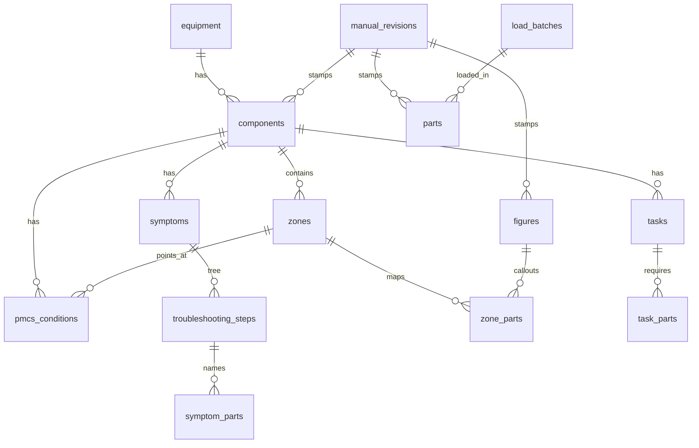

# 01 Database Schema (nine core tables + one view, plus support tables)

> **Rough bookmark, not a finished spec.** It captures what we discussed so the concept is understood. Start at `00`.

Purpose: store structured data extracted from TMs and parts manuals (RPSTL) so the software can support maintenance planning, parts availability checks and time-to-repair estimates.

**Engine:** SQLite with SQLCipher (`06` OD-3). Run `PRAGMA foreign_keys=ON` on every connection. Every foreign key uses `ON DELETE RESTRICT`, because old revisions are kept.

**About "ten tables":** the original design counted ten. Honestly, that's **nine core tables plus one view** (`parts_to_symptoms`). The capabilities also need **support tables** (listed below) that hold no new manual concept: references, inventory, provenance and lineage. Whether to keep calling this "the ten" is `06` OD-9. Recommended: "ten core objects plus support tables".

## Columns every extracted row carries
`revision_id INTEGER NOT NULL` (FK manual_revisions), `source_page TEXT NOT NULL` (page label as printed), `change_no INTEGER NOT NULL DEFAULT 0` (the page's "Change N"), `marking TEXT NOT NULL` (FK markings), `batch_id INTEGER NOT NULL` (FK load_batches). Each row carries the revision of **its own** source publication (TM or RPSTL). Links between the two manuals join on `part_number_norm`, never on a row id, and resolve to the current revision at query time (`03`).

## Core tables
| # | Table | Key | Columns (type) | Source |
|---|---|---|---|---|
| 1 | components | component_id INTEGER PK | equipment_id INT FK, parent_component_id INT FK self (same revision, no cycles; checked at load), name TEXT, system_level TEXT, group_code TEXT | tech parser |
| 2 | parts | part_id INTEGER PK; UNIQUE(revision_id, part_number_norm, cage_code) | part_number_raw TEXT, part_number_norm TEXT (indexed), cage_code TEXT, nsn TEXT (format 4-2-3-4 digits or NULL), description TEXT, category TEXT, consumable_flag INTEGER CHECK IN (0,1), unit_of_issue TEXT | parts parser |
| 3 | symptoms | symptom_id INTEGER PK; UNIQUE(revision_id, symptom_code) | symptom_code TEXT (rule: `<publication_number>:<malfunction number as printed>`), title TEXT, component_id INT FK | tech parser |
| 4 | symptom_parts | PK(symptom_id, step_id, part_number_norm) | symptom_id FK, step_id FK troubleshooting_steps, part_number_norm TEXT, confidence_score REAL CHECK 0 to 1, NULL until capability 10 | tech parser |
| 5 | pmcs_conditions | condition_id INTEGER PK | component_id FK, zone_id FK (must belong to the same component; checked at load), item_no TEXT, condition_text TEXT, threshold_min REAL, threshold_max REAL, unit TEXT, comparator TEXT CHECK IN ('<','<=','>','>=','between','present','absent'), nmc_flag INTEGER CHECK IN (0,1), essentiality_code TEXT FK essentiality_codes | tech parser |
| 6 | zones | zone_id INTEGER PK | component_id FK, name TEXT | tech parser (PMCS item locations) |
| 7 | zone_parts | PK(figure_id, callout_id) | zone_id FK (from the reviewed zone_figure_map, `02`), figure_id FK figures, callout_id TEXT, part_number_norm TEXT, quantity INTEGER, unit_of_issue TEXT | parts parser |
| 8 | task_parts | PK(task_id, part_number_norm) | task_id FK tasks, part_number_norm TEXT, quantity INTEGER, unit_of_issue TEXT, mandatory_replacement INTEGER NOT NULL CHECK IN (0,1) DEFAULT 0 | tech parser (procedure "parts/materials required" lists). `mandatory_replacement = 1` means the work order adds the part on its own (`05`) |
| 9 | manual_revisions | revision_id INTEGER PK; UNIQUE(publication_number, revision_seq) | publication_number TEXT, manual_type TEXT CHECK IN ('TM','RPSTL'), revision_label TEXT, revision_date TEXT (ISO 8601), revision_seq INTEGER (from the approved publication index, never parsed, `03`), supersedes_revision_id INT FK self, supersession_notice TEXT, banner_marking TEXT FK markings, cui_categories TEXT, designation_indicator TEXT, distribution_statement TEXT, export_warning INTEGER CHECK IN (0,1), source_sha256 TEXT, ingested_at TEXT (UTC) | preprocessing step 6 + the owner's publication index |
| 10 | parts_to_symptoms | **VIEW** (not loaded, no CSV) | part_number_norm, symptom_code, step_id, component_id, revision_id: symptom_parts joined to symptoms | derived |

## Support tables
| Table | Key | Columns | Why |
|---|---|---|---|
| equipment | equipment_id PK | model TEXT, nomenclature TEXT | "Equipment ID" input (`05`). Entered by the owner |
| figures | figure_id PK; UNIQUE(revision_id, figure_number) | figure_number TEXT, title TEXT, source_page | Join key figure + callout; handles callouts reused across figures |
| tasks | task_id PK | component_id FK, task_name TEXT, labor_hours_min REAL, labor_hours_max REAL, mac_ref TEXT | Time-to-repair labor (`05` cap 7). Labor from the TM Maintenance Allocation Chart (MAC) |
| troubleshooting_steps | step_id PK | symptom_id FK, parent_step_id FK self, step_no TEXT, outcome TEXT CHECK IN ('yes','no','n/a'), task_id FK NULL | Tree structure for branches and time-to-repair |
| inventory | PK(part_number_norm, source) | on_hand_qty INTEGER, as_of TEXT (UTC), source TEXT CHECK IN ('DSI','SMU','RIP') | On-hand quantity from the three inventories (`05`, `06` OD-6). Not manual data and not revision-stamped. Lead time is not stored here; it is a preference |
| work_orders | work_order_id PK | created_at TEXT (UTC), status TEXT CHECK IN ('open','closed') | One planning work order (`05`). Vehicle columns are not in v1 |
| work_order_issues | PK(work_order_id, symptom_id) | work_order_id FK, symptom_id FK, action TEXT NOT NULL CHECK IN ('diagnose','repair','replace'), included INTEGER NOT NULL CHECK IN (0,1) DEFAULT 1 | Major defects chosen from the troubleshooting manual. The system is that symptom's component. `action` is the planner's pick. `included` is the work-order checkbox. On means the defect is on the defect list and in the time (`05`) |
| work_order_other_defects | other_defect_id PK | work_order_id FK, defect_text TEXT NOT NULL, included INTEGER NOT NULL CHECK IN (0,1) DEFAULT 1 | Other LTI defects. The printed system is always `Other`. `included` is the work-order checkbox (`05`) |
| system_action_averages | PK(component_id, action) | component_id FK, action TEXT CHECK IN ('diagnose','repair','replace'), avg_days REAL, enabled INTEGER NOT NULL CHECK IN (0,1) DEFAULT 1 | Preferences. Average days for that system and action, and whether that action is turned on. Lead time is one app preference, not a row here |
| part_supersessions | PK(old_pn_norm, new_pn_norm, revision_id) | interchangeability TEXT | Part-number supersession chains (`03`) |
| revision_diffs | diff_id PK | from_revision_id, to_revision_id, table_name, natural_key, change_type CHECK IN ('added','removed','changed'), column_name, old_value, new_value | `03` diff results |
| load_batches | batch_id PK | revision_id, manifest_sha256, confirmed_by (macOS user), confirmed_at (UTC), loaded_at (UTC), pnnorm_version | Who confirmed what was loaded (the load confirm step, `02`, `06` OD-14) |
| markings | marking_code PK | rank INTEGER, description | Lookup. "Highest marking" = max rank. Seeded with `U` (rank 0) and `CUI` (rank 1); category and LDC suffixes are added as captured |
| essentiality_codes | code PK | description | Domain for pmcs_conditions |
| pmcs_results | result_id PK | equipment_id, condition_id, measured_value REAL, observed_at (UTC), entered_by | Capability 5 input |
| diagnostic_outcomes | outcome_id PK | symptom_id, part_number_norm, confirmed INTEGER, entered_by, observed_at | Capability 10 (deferred) |

The audit log lives **outside** the database (`04`), because SQLCipher decrypts when the file opens, before any SQL can run.

## Live-query views
`current_<table>` views pick the latest approved revision per publication (`03`). Capabilities query only `current_*` views and `parts_to_symptoms`.

## Indexes
Index every FK column, `part_number_norm`, and (`revision_id`, natural key).

## Relationships

`parts_to_symptoms` is a view over `symptom_parts` + `symptoms`, so it isn't drawn as an entity. Part links (`symptom_parts`, `zone_parts`, `task_parts`, `inventory`) join to `parts` on `part_number_norm`.
