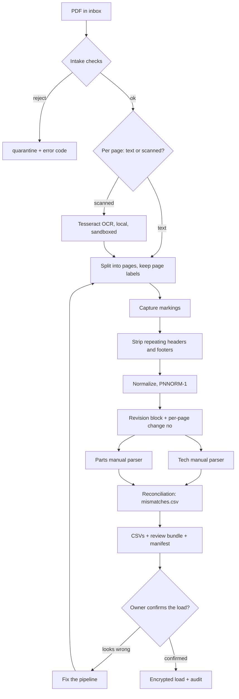

# 02 PDF Extraction Pipeline Logic Spec

> **Rough bookmark, not a finished spec.** It captures what we discussed so the concept is understood. Start at `00`.
> Revised 2026-10-30: the owner runs this from the WorkOrder app, not a terminal.

The owner runs this pipeline from the WorkOrder app (`05`, `06` OD-19). It works offline, and every file it reads or writes is in the encrypted data location (`09`). Grok Build writes the code and never runs it on real manuals. Inputs are TM and parts manual (RPSTL) PDFs. Outputs are CSVs whose columns match `01`, plus a review bundle. No AI or LLM component touches any content.

## Isolation for every step
Each PDF is parsed in its own child process (`06` OD-16): no network, input opened read-only, output written only to that batch's folder, and no access to keys. Limits: 600 s wall time (the child is killed), 3000 pages and 50 megapixels per page image (checked in code), and 2 GB memory where macOS enforces it. Hitting a limit fails that file closed (error code, no partial output). Scratch files go to `tmp/<batch>/` in the data location (`04` S8).

## Shared preprocessing (runs before both parsers)
0. **Intake.** Check the file by magic bytes and structure, and reject anything that isn't a clean PDF. Reject password-protected PDFs. Drop JavaScript, launch/URI actions, embedded files, annotations, form fields and metadata before parsing (keep only content streams). Record `source_sha256`. Rejected files go to `quarantine/` in the data location with an error code, and nothing else is written.
1. **Decide per page** (not per file) as text or scanned. A page is scanned if its text layer has fewer than 200 characters (`06` OD-11). Scanned pages go through local Tesseract (300 dpi, `eng`, page segmentation mode 6, per-word confidence kept). For text pages, also OCR a rendered copy and flag the page when OCR and the text layer disagree by more than 10% of tokens. That catches hidden text or font remapping. Record the method per page.
2. **Split** into one text file per page under `batches/<batch>/pages/`. Keep the printed page label and the PDF page index. Page labels are join keys and become `source_page`.
3. **Capture markings (before any stripping).** From each page's top and bottom lines, and from the first page or cover:
   - banner marking (for example `CUI`, `CUI//SP-...`, LDC suffixes)
   - portion markings at paragraph or table starts (`(CUI)`, `(U)`)
   - the designation indicator block ("Controlled by", "CUI Category", "Distribution/Dissemination Control", "POC")
   - the distribution statement (`DISTRIBUTION B` to `F` text)
   - the export-control warning

   Store them per page in `batches/<batch>/markings.csv`, and on `manual_revisions` (banner, categories, indicator, distribution statement, export_warning). **Every page is treated as at least `CUI`, even if no marking is found.** A page with no detectable marking goes on the review list instead of being marked `U`.
4. **Detect and strip** the headers and footers that repeat on every page (after step 3 has captured them).
5. **Normalize** whitespace and fix OCR artifacts: part numbers broken across line wraps, and stray characters from leader lines.
6. **Revision block.** Find the publication number, revision label, revision date and supersession notice (title page, cover, or a standardized header). Also capture each page's "Change N" number into `change_no`. These are **candidate** values. `revision_seq` comes only from the approved publication index (`03`).

## Part-number normalization rule PNNORM-1 (versioned; the version is stored on load_batches)
Uppercase, trim, remove internal spaces, keep dashes and slashes. Keep `part_number_raw` unchanged. CAGE code and NSN go in their own columns, never concatenated. No letter-for-digit substitution (O/0, I/1): suspected OCR confusions go to `low_confidence.csv` instead of being "fixed". Changing the rule creates PNNORM-2. Never edit PNNORM-1 in place.

## Tech manual parser (TM) emits
`components` (from the functional group structure), `symptoms` (malfunction number + title; `symptom_code` rule in `01`), `troubleshooting_steps` (the step tree with yes/no outcomes), `symptom_parts`, `zones` (PMCS item locations), `pmcs_conditions` (threshold parsed into min/max/unit/comparator; anything unparseable goes to review), `tasks` (with MAC labor hours) and `task_parts` (the procedure's "parts/materials required" list).
**Part reference rule:** if a troubleshooting step prints a part number, use PNNORM-1. If it names a part only by name, match the name against `parts.description` within the same component's figures. Zero or multiple matches go to `unresolved_refs.csv` (row IDs and page only) for the review step. Never guess.

## Parts manual parser (RPSTL) emits
`figures`, `parts`, `zone_parts` and `part_supersessions`. Method: extract the parts-list **table** (callout/item, part number, CAGE, NSN, description, unit of issue, quantity) from the text layer or OCR, and link it to its figure number. Reading the diagram image itself is out of scope for v1. No cropped diagram images are produced or kept.
Two traps:
- The same callout reused across figures. The key is (figure_id, callout_id), never callout alone.
- A parts list split across pages, with the figure number only in a header. Carry the last seen figure number forward until a new figure header appears, and flag the carried rows.

**Zones to figures:** `zone_parts.zone_id` comes from `zone_figure_map.csv`. The software proposes the map by matching zone name to figure title, and the owner confirms it at the review step (`06` OD-8). Unmapped zones are mismatch M3.

## Cross-parser reconciliation (keys and mismatch types)
Join on `part_number_norm`, plus (figure_id, callout_id) where present. Write `mismatches.csv` with columns (mismatch_id, type, table, row_id, source_page) and **no content**:
- M1: a part_number_norm in symptom_parts, task_parts or zone_parts that isn't in parts
- M2: duplicate (figure_id, callout_id)
- M3: a zone with no figure mapping
- M4: an unresolved TM part reference
- M5: a page with no captured marking

The load step refuses any bundle with a count above zero. The owner tells Grok Build the counts and mismatch_ids, and Grok Build fixes the pipeline.

## Error handling
Each file succeeds or fails as a whole. Failures (corrupt, encrypted, limit hit, OCR failure, no revision block found) are written to `batches/<batch>/run_log.jsonl` as structured JSON events (file sha256, step, error code, page index) with no content. No partial tables are ever emitted. Exit codes: 0 success, 10 intake reject, 20 limit hit, 30 parse failure, 40 mismatches > 0.

## Output artifacts and the review bundle
One CSV per core and support table that gets loaded (not the view), UTF-8, RFC 4180, header row, empty field = NULL, and a `marking` column on every row. Any cell starting with `=`, `+`, `-`, `@`, tab or CR is prefixed with `'` (prevents formula execution). The review bundle at `batches/<batch>/review/` contains the CSVs, `mismatches.csv`, `low_confidence.csv`, `unresolved_refs.csv`, `zone_figure_map.csv`, an optional `overrides.csv`, `MARKING.txt` (the highest marking in the bundle, shown first), and `manifest.sha256` covering every file.

## Human review and the load confirm step
The owner reviews the bundle on the Review screen (`05`). `MARKING.txt` is shown first. No office suite, no cloud preview, no Quick Look, no Preview, and no browser. If the data looks wrong, fix the pipeline. **Overrides:** a one-off OCR misread that the pipeline can't fix may be corrected on that screen, which writes `overrides.csv` (row_id, column, new_value, reason). The override file is covered by the manifest, applied by the load step, and audit-logged.
**Load confirm (`06` OD-14):** the Load screen re-hashes every file against `manifest.sha256`, then shows the owner the manifest sha256, the highest marking and the row and mismatch counts. It loads only after he types the first 8 characters of that sha256 into that screen. It refuses if any file changed, if any mismatch count is above 0, or if the confirm is wrong. It records confirmed_by, confirmed_at and manifest_sha256 in `load_batches` and writes an audit event either way. There is no signature.

## Flow

