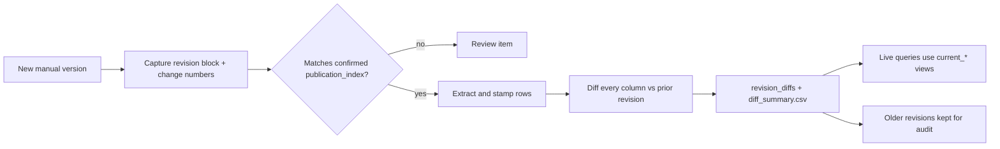

# 03 Revision Tracking

> **Rough bookmark, not a finished spec.** It captures what we discussed so the concept is understood. Start at `00`.

1. **Capture** the revision block during preprocessing (`02` step 6): publication number, revision label, revision date and supersession notice, stored in `manual_revisions`. Also capture each page's "Change N" number into the row's `change_no`. These parsed values are candidates only.
2. **Order by the approved index, never by parsed values.** The owner keeps `publication_index.csv` (publication_number, revision_label, revision_seq, supersedes, source of the record) in the data location. Its sha256 goes in the review bundle manifest, so the owner confirms it at the load confirm step along with the bundle (`02`). `revision_seq` and `supersedes_revision_id` come only from that file. If the parsed revision block disagrees with the index, that's a review item. This stops a forged block (future date, higher letter) from becoming "latest".
3. **Stamp** every extracted row with the `revision_id` of its own publication (TM and RPSTL are revised separately) and the `change_no` of its source page. With a change package that replaces only some pages, unchanged pages keep their earlier change number.
4. **Diff** each new revision against the previous one for the same publication, on natural keys (parts: part_number_norm + cage_code; zone_parts: figure_number + callout_id; symptoms: symptom_code; pmcs_conditions: item_no; tasks: task_name + component). Compare **every column**, not just part numbers (quantities, thresholds, NMC flags, essentiality codes and task parts all count). Write the results to `revision_diffs` (added / removed / changed, column, old, new) and to `diff_summary.csv` (counts only) in the review bundle.
5. **Default to the latest revision** for live queries: `current_*` views select MAX(revision_seq) per publication among approved batches. Older revisions stay in the database for audit (retention: `06` OD-10).
6. **Part-number supersession:** `part_supersessions` rows (old to new, with interchangeability) come from the parts manual. Lookups follow the chain to the newest part number and show both.

