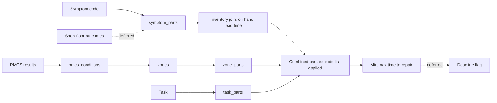

# 05 Software Capability Map

> **Rough bookmark, not a finished spec.** It captures what we discussed so the concept is understood. Start at `00`.
> Revised 2026-10-30: capabilities are screens in the Mac app, not terminal commands.

The owner opens the WorkOrder app and unlocks the database with his hardware key (`04` S5, `06` OD-19). Each query is audited (capability number and row count only). Queries read only `current_*` views and `parts_to_symptoms` (`03`). Every screen that shows rows carries the highest marking of those rows at the top and the bottom (`04` S6).

## Screens
One app, one window at a time. The marking banner stays up whenever rows are on screen.

| Screen | What he does |
|---|---|
| First run | Picks the encrypted data volume. The app saves only that path, outside the repo (`09`). |
| Unlock | Hardware-key check. Idle lock (15 minutes) returns here and wipes the key from memory. |
| Status | Shows encrypted volume, outside repo, FIPS provider, network sandbox, Spotlight exclusion, Time Machine exclusion, SQLCipher, and cipher settings. Each is yes or no, or a named setting. |
| Manuals | Lists PDFs already in `manuals/`. Starts a batch. Quarantine shows an error code and nothing else. |
| Run | Per file: step, error code, page index. No page text. |
| Review | Tables from the review bundle, `MARKING.txt` first. He confirms the zone-to-figure map and may correct one cell by row id (`02`). |
| Load | Manifest sha256, highest marking, row counts, mismatch counts. Loads only after he types the first 8 characters of the sha256 (`06` OD-14). |
| Imports | Inventory, parts requests, PMCS results, the publication index, and the exclude list. The file picker cannot leave the data location. |
| Planning | Equipment, then capabilities 1 to 7 below. |
| Audit | Chain check and the head hash. He runs it weekly and writes the head hash on paper. |
| Maintain | Backup, restore to a scratch encrypted image, and purge of one batch. |

## Inputs
| Input | Form | Where it goes |
|---|---|---|
| Equipment ID | chosen from `equipment` | scopes every query |
| Symptom code | `symptom_code` (rule in `01`), from a limited technical inspection | cap 1, 7 |
| PMCS inspection results | `pmcs_results.csv` (condition_id, measured_value or present/absent), imported into `pmcs_results` | cap 5, 6 |
| Parts request lists from the maintenance team | `request.csv` (part_number_raw, quantity), normalized by PNNORM-1 | cap 2, 4 |
| Inventory | `inventory.csv` (part_number_raw, location, on_hand_qty, lead_time_days, as_of), imported into `inventory` (`06` OD-6) | cap 1, 4, 7 |
| Manual PDFs | pipeline only (`02`), never a query input | |

## Capabilities (rules)
1. **Symptom to parts.** For a symptom, list the parts named in its troubleshooting steps (`symptom_parts`), joined to `inventory` on part_number_norm, following supersession to the newest part number (`03`). Each part shows as on hand (on_hand_qty > 0) or not on hand, with lead_time_days. A part with no inventory row shows as "not on hand, lead time unknown".
2. **Reverse lookup.** For a batch of part numbers, return their symptom, component and system associations from `parts_to_symptoms`. A part linked to symptoms under two or more different components is highlighted as a possible fault cluster across systems.
3. **Exclude list.** By default, results hide parts with `consumable_flag = 1` or a category in `exclude_categories.csv` (kept by the owner in the data location: bolts, washers, gaskets and so on). One switch shows them again. Hidden counts are always shown.
4. **Combined cart.** Merge the task's `task_parts` with the diagnosis parts (cap 1 or a request list) into one cart: group by part_number_norm, sum quantities (diagnosis parts count 1 unless given), keep a source tag per line, apply cap 3.
5. **PMCS evaluation.** Compare each result to its `pmcs_conditions` row using the comparator and min/max in the same unit. Show only failed conditions with `nmc_flag = 1` (they ground the asset). A condition whose threshold wasn't parsed shows as "check by hand", never as passed.
6. **Zone to parts.** Each failed condition from cap 5 leads to its zone, and `zone_parts` (through the reviewed zone-to-figure map) lists that zone's candidate parts, with inventory status as in cap 1.
7. **Time-to-repair estimate (min/max, in days).**
   - Tasks: the repair tasks reached in the symptom's troubleshooting tree (`troubleshooting_steps.task_id`).
   - Labor: MAC hours from `tasks`. Tasks are done one after another by one crew (serial). Days = hours / shop hours per day (`06` OD-12, default 8), rounded up.
   - **Min** = the shortest path through the tree, using `labor_hours_min`, plus the largest lead time of any not-on-hand part on that path (zero if all are on hand).
   - **Max** = the longest path, using `labor_hours_max`, plus the largest lead time among its not-on-hand parts. Parts are ordered at the same time, so lead times don't add up.
   - If `labor_hours_min` and `labor_hours_max` aren't printed separately, both equal the MAC hours (`06` OD-12). An unknown lead time makes max "unknown" and says why.
8. **Deadline flag (deferred, rule fixed).** Modeled on the MEL (Minimum Equipment List). Input: a deadline date per equipment. Flag when today + max days > deadline, and name the parts that push it past. Build after 1 to 7 are accepted (`06` D1).
9. **Quantity roll-up (deferred).** Totals at the assembly level across multiple figures, rather than raw per-figure sums (`06` D2).
10. **Feedback loop (deferred).** Real shop-floor outcomes (`diagnostic_outcomes`) update `symptom_parts.confidence_score` (`06` D3).

## Build order
One engine system and one symptom (the owner picks them, `06` OD-5), end to end. Build capabilities **1 to 7** in order, each passing its tests in `10`. Then tell the owner in the chat, and build 8 to 10 only when he says so (`11`).

