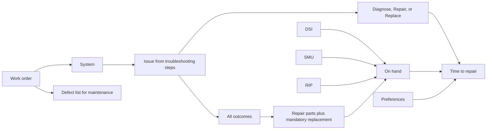

# 05 Software Capability Map

> **Rough bookmark, not a finished spec.** It captures what we discussed so the concept is understood. Start at `00`.
> Revised 2026-10-31: he unlocks the encrypted database with a passphrase. The disk is not encrypted.
> Revised 2026-10-31: the planner opens a work order. This file describes that work order. The older seven-query layout is not what v1 builds.
> Revised 2026-10-31: repair time is a system average for Diagnose, Repair, or Replace. The work order also prints a defect list for maintenance.
> Revised 2026-10-31: the defect list is a generated PDF. Equipment and Quality Control are on the screen. The Mechanic section is blank lines on the PDF only.
> Revised 2026-10-31: Preferences shows the whole system name in the wide column, with a checkbox for Diagnose, Repair, and Replace. The defect list is the defects turned on from the Work order page. The window has Light and Dark.
> Revised 2026-11-01: File > New opens a work order in its own window. That window has Main Work Order and Defects. The main window Status board is Open, Maint, Close, and Archive. Equipment lookup is later.

The owner opens the WorkOrder app and unlocks the database with his passphrase (`04` S5, `06` OD-21). A work order reads only `current_*` views (`03`). Every screen that shows rows carries the highest marking of those rows at the top and the bottom (`04` S6). The people using it are planners, and the estimate is there so maintenance can set priorities.

## Screens
One app. The main window holds Status, Library, and Preferences. File > New opens a work order in its own window, with two tabs: Main Work Order, and Defects. Closing that window keeps the work order. The marking banner stays up whenever rows are on screen. The File menu has New, Open, Save, Save As, Import, Export, and Close.

The Status item on the main window is the maintenance lifecycle. Each work order is a card in Open, Maint, Close, or Archive. A new work order starts in Open. He moves it from the card. This is not the database Status screen in the table below. Equipment lookup is a later tab on the main window, for past work orders. It is not in this stage. Do not invent equipment fields.

| Screen | What he does |
|---|---|
| First run | Picks a normal folder. Chooses a passphrase and types it again. The app creates `workorder.db` there and encrypts that file (`09`, `04` S4). |
| Unlock | He types the passphrase. The right one opens the database. A wrong one does not. After 15 minutes idle, the app asks again. |
| Status | Shows database file present, database encrypted, folder outside the repo. Each is yes or no. |
| Manuals | He selects a troubleshooting manual PDF and a parts manual PDF. The app reads them (`02`). It does not encrypt or decrypt the PDF. |
| Run | Per file: step, error code, page index. No page text. |
| Review | Tables from the review bundle, `MARKING.txt` first. He confirms the zone-to-figure map and may correct one cell by row id (`02`). |
| Load | Manifest sha256, highest marking, row counts, mismatch counts. Loads only after he types the first 8 characters of the sha256 (`06` OD-14). |
| Imports | Three on-hand lists: DSI, SMU, and RIP. Each row is a part number and a quantity (`06` OD-6). |
| Work order | File > New opens it in its own window. Main Work Order tab: vehicle section (blank for later), major defects by system from the troubleshooting manual, other defects as free text, Diagnose / Repair / Replace, outcomes, parts, on-hand quantities, and the time estimate. Defects tab: the defect list. |
| Library | Publications grouped by platform, with the upload date. A platform opens to its maintenance and technical publications, because that list gets long. DSI, SMU, and RIP show their import dates on the front of the page. |
| Preferences | For each system, the whole name in the wide column. Diagnose, Repair, and Replace each have a checkbox and the average days. A checked action is used on the work order. Also the average lead time in days when a part is not on hand (`06` OD-12). Light and Dark are in Preferences. |
| Audit | Chain check and the head hash, when he wants to look. |
| Maintain | Backup, restore, and purge of one batch. |

## What a work order is
A planner opens a new work order. The vehicle section is on the screen and is empty in v1. Vehicle fields are developed later.

He then lists the defects from a limited technical inspection. The inspection is by **system**, not by platform. Engine is one system. Transmission is another.

**Major defects** are chosen from the troubleshooting manual. He picks the system, then picks the defect from that system's troubleshooting steps. "No Crank, No Start" and "won't shift into 4th gear" are examples. He does not type a major defect the manual does not contain. For each one he also picks the work: **Diagnose**, **Repair**, or **Replace**. Replace means replacing that system.

**Other defects** are the ones that are not in the troubleshooting steps. Each line is system `Other` and free-form text. They are for the maintenance list. They do not pull parts and they do not add time.

## What the work order pulls
For each selected issue the app reads that issue's troubleshooting tree (`troubleshooting_steps`):

- Every outcome, not one path chosen in advance. The yes and no branches are different ways the repair can go.
- The parts that repair requires (`task_parts` and `symptom_parts`), matched to the parts manual by `part_number_norm`, following supersession to the newest part number (`03`). The estimate does not use per-task labor hours from the manual.
- Any part on that repair with `mandatory_replacement = 1` is added on its own.

Each part line shows the on-hand quantity in DSI, in SMU, and in RIP. On hand means the three quantities together cover the required quantity. A part in none of the three lists is not on hand.

## Time to repair
The clock time is not built defect by defect from the manual. For each system, Preferences holds three averages, in days: Diagnose, Repair, and Replace. The planner can change those averages.

- Each major defect adds the average for its system and the action he picked. Engine Repair and Transmission Diagnose are two different numbers, and they add.
- There is no short path and no long path from the troubleshooting tree. The tree supplies the parts. The averages supply the days.
- If a system has no average yet for the action he picked, the estimate says so and waits for him to enter it in Preferences. The app does not fill in a number.
- If any required part is not on hand, add the average lead time once for the whole work order. Lead times do not add per part.

## Defect list
The defect list is a report. The planner generates it as a PDF. Sections stack down the page, each one full width. A section's own list splits down the middle into two columns so the width of that section gets used.

The Defects tab shows Equipment and Quality Control, and the button that writes the PDF. The Mechanic section is not on the screen. The lines on the screen are the defects the planner turned on from the Work order page. The defect list screen does not add or uncheck them.

**Equipment.** The top section of the screen and of the PDF. It is present in v1 and its fields are not designed yet. More header items will be added later. Do not invent them.

**Quality Control.** The next section, on the screen and on the PDF. What QC found on the limited technical inspection, limited to the defects turned on from the Work order page. On the work order, each defect has a checkbox and starts on. Unchecking it takes it off this list and out of the time estimate. The lines fill the left column, then the right column. On the PDF, each line has an empty box so maintenance can mark the paper. They are:

- Major: `[System] - [Troubleshooting Defect]`. Example: `Engine - No Crank, No Start`.
- Other: `Other - [free-form Defect]`.

**Mechanic.** Drawn only when the PDF is generated. Blank lines, in two columns. The mechanic writes on the PDF what was found on the detailed technical inspection. Nothing is prefilled. The app does not store those lines. These lines do not pull parts and do not change the time estimate.

## Preferences
For each system that appears in the troubleshooting manual, the whole system name is the wide column. Average days to Diagnose, average days to Repair, and average days to Replace sit beside it. Each of those three has a checkbox. Checked means that action can be picked on a work order and its days count. Unchecked leaves that action out of the estimate. A defect already added still stays on the defect list. One average lead time, in days, for a part that is not on hand. No per-task repair times. No shop-hours divisor (`06` OD-12).

The window follows the Mac appearance until the planner chooses Light or Dark.

## Ingest, before any work order
| Input | What it supplies |
|---|---|
| Troubleshooting manual PDF | Systems, defects, troubleshooting steps, outcomes, repair parts, mandatory-replacement flags |
| Parts manual PDF | Part numbers, CAGE, NSN, description, quantity, supersession |
| DSI, SMU, and RIP lists | On-hand quantity for a part number. No lead time |

The planner selects the PDFs. The app reads them (`02`). It does not encrypt them and it does not decrypt them.

## Not in v1
The fields inside the equipment header, and any later header items. A deadline flag. Assembly-level quantity roll-up. Shop-floor confidence scores. PMCS pass/fail, zone-to-parts, a reverse part lookup, an exclude list, and a separate parts-request cart. Those stay out until the owner asks for one.

## Build order
One work order against one troubleshooting manual and its parts manual (`06` OD-5). Build the work order above, including Preferences and the three inventories. Then tell the owner in the chat.

